

<a href="https://karthickraja.page"><picture><source media="(prefers-color-scheme: light)" srcset="./cards/light/hero.svg"></picture></a>

<picture><source media="(prefers-color-scheme: light)" srcset="./cards/light/heatmap.svg"></picture>

<picture><source media="(prefers-color-scheme: light)" srcset="./cards/light/activity.svg"></picture>

<a href="https://github.com/KarthickRaja46/API-Performance-Monitoring-Analytics"><picture><source media="(prefers-color-scheme: light)" srcset="./cards/light/tile-sql.svg"></picture></a>
<a href="https://github.com/KarthickRaja46/Business-Performance-Customer-Intelligence"><picture><source media="(prefers-color-scheme: light)" srcset="./cards/light/tile-powerbi.svg"></picture></a>
<a href="https://github.com/KarthickRaja46?tab=repositories&language=python"><picture><source media="(prefers-color-scheme: light)" srcset="./cards/light/tile-python.svg"></picture></a>

<picture><source media="(prefers-color-scheme: light)" srcset="./cards/light/sec-dashboards.svg"></picture>

<a href="https://app.powerbi.com/view?r=eyJrIjoiZTNjNzZiNGItYjM3Zi00NDNjLWFhODMtNjNiZjlkMWI4NjQ4IiwidCI6IjNjYjM3ODQ0LTAxZGEtNGJlYS04MDEwLTBmYjFmNWExZWM0ZSJ9"><picture><source media="(prefers-color-scheme: light)" srcset="./cards/light/dash-volt.svg"></picture></a>
<a href="https://app.powerbi.com/view?r=eyJrIjoiMWQxMzFjYTAtZjkxMi00YzViLTg2NTktMGI5Y2YzNWRkNDBkIiwidCI6IjNjYjM3ODQ0LTAxZGEtNGJlYS04MDEwLTBmYjFmNWExZWM0ZSJ9"><picture><source media="(prefers-color-scheme: light)" srcset="./cards/light/dash-claim.svg"></picture></a>
<a href="https://app.powerbi.com/view?r=eyJrIjoiMjg1MTcwZjktZTViMy00OTU3LTgyMTctNGIzNTRhNWYwYWM1IiwidCI6IjNjYjM3ODQ0LTAxZGEtNGJlYS04MDEwLTBmYjFmNWExZWM0ZSJ9"><picture><source media="(prefers-color-scheme: light)" srcset="./cards/light/dash-bank.svg"></picture></a>
<a href="https://app.powerbi.com/view?r=eyJrIjoiYzlhM2FhNDktZWI5Yi00MGU4LThkMTAtNGFlNzY4YjIyMGM5IiwidCI6IjNjYjM3ODQ0LTAxZGEtNGJlYS04MDEwLTBmYjFmNWExZWM0ZSJ9"><picture><source media="(prefers-color-scheme: light)" srcset="./cards/light/dash-api.svg"></picture></a>
<a href="https://app.powerbi.com/view?r=eyJrIjoiMjRmN2U0OTUtZTJmZi00ZjhhLTkxZmEtOGI3MzRmN2QxZTE3IiwidCI6IjNjYjM3ODQ0LTAxZGEtNGJlYS04MDEwLTBmYjFmNWExZWM0ZSJ9"><picture><source media="(prefers-color-scheme: light)" srcset="./cards/light/dash-retail.svg"></picture></a>
<a href="https://github.com/KarthickRaja46/Business-Performance-Customer-Intelligence"><picture><source media="(prefers-color-scheme: light)" srcset="./cards/light/dash-biz.svg"></picture></a>

<picture><source media="(prefers-color-scheme: light)" srcset="./cards/light/report.svg"></picture>

<picture><source media="(prefers-color-scheme: light)" srcset="./cards/light/sec-projects.svg"></picture>

<a href="https://github.com/KarthickRaja46/Real-Estate-Price-Prediction"><picture><source media="(prefers-color-scheme: light)" srcset="./cards/light/repo-1.svg"></picture></a>
<a href="https://github.com/KarthickRaja46/Bird-Species-Audio-Classification"><picture><source media="(prefers-color-scheme: light)" srcset="./cards/light/repo-2.svg"></picture></a>
<a href="https://github.com/KarthickRaja46/Investment-Portfolio-Analytics"><picture><source media="(prefers-color-scheme: light)" srcset="./cards/light/repo-3.svg"></picture></a>
<a href="https://github.com/KarthickRaja46/Data-Analyst-Job-Tracker"><picture><source media="(prefers-color-scheme: light)" srcset="./cards/light/repo-4.svg"></picture></a>

<picture><source media="(prefers-color-scheme: light)" srcset="./cards/light/stack.svg"></picture>

<a href="https://linkedin.com/in/karthick-raja/"><picture><source media="(prefers-color-scheme: light)" srcset="./cards/light/contact.svg"></picture></a>

<a href="https://linkedin.com/in/karthick-raja/"><picture><source media="(prefers-color-scheme: light)" srcset="./cards/light/btn-linkedin.svg"></picture></a>
<a href="mailto:karthiikarthii46@gmail.com"><picture><source media="(prefers-color-scheme: light)" srcset="./cards/light/btn-email.svg"></picture></a>
<a href="https://karthickraja.page"><picture><source media="(prefers-color-scheme: light)" srcset="./cards/light/btn-portfolio.svg"></picture></a>

<b>More about me</b>

 

**Data Analyst Intern, [Besant Technologies](https://besant.in/)** · Chennai · Feb 2026

- Processed and validated **50,000+ records** with Python (Pandas) and Excel at **99.8% accuracy**
- Wrote **40+ SQL queries** for KPI reporting, latency analysis and automated alerts
- Built interactive **Power BI dashboards** with DAX measures, Power Query, slicers and drill-through pages
- Automated repetitive reporting workflows in Python, improving efficiency by **40%**

**B.E. Computer Science & Engineering**, Hindusthan Institute of Technology, Coimbatore · Apr 2026

Every card above is an SVG drawn by <a href="scripts/render_readme_cards.py">one Python script</a> from my contribution data, redrawn every morning by a GitHub Action.

