  

<a href="https://linkedin.com/in/karthick-raja/">LinkedIn</a> &nbsp;·&nbsp;
<a href="mailto:karthiikarthii46@gmail.com">Email</a> &nbsp;·&nbsp;
<a href="https://karthickraja.com">Portfolio</a> &nbsp;·&nbsp;
<a href="https://github.com/KarthickRaja46?tab=repositories">All repositories</a>

<b>More about me</b>

 

**Data Analyst Intern, [Besant Technologies](https://besant.in/)** · Chennai · Feb 2026

- Processed and validated **50,000+ records** with Python (Pandas) and Excel at **99.8% accuracy**
- Wrote **40+ SQL queries** for KPI reporting, latency analysis and automated alerts
- Built interactive **Power BI dashboards** with DAX measures, Power Query, slicers and drill-through pages
- Automated repetitive reporting workflows in Python, improving efficiency by **40%**

**B.E. Computer Science & Engineering**, Hindusthan Institute of Technology, Coimbatore · Apr 2026

**Stack:** SQL · MySQL · Power BI · DAX · Power Query · Excel · Python · Pandas · NumPy · Matplotlib · Seaborn · Streamlit · Git

Every card above is an SVG drawn by <a href="scripts/render_readme_cards.py">one Python script</a> from my contribution data, redrawn every morning by a GitHub Action.

